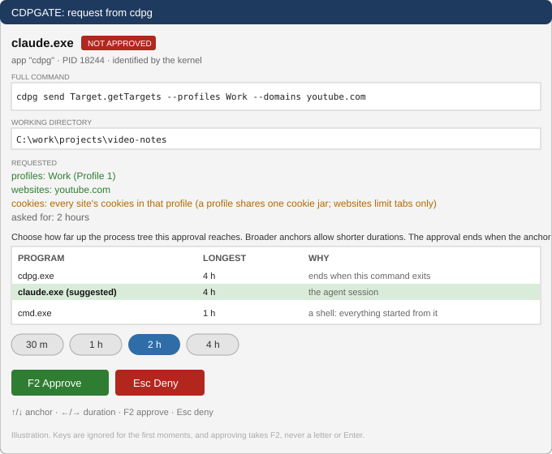
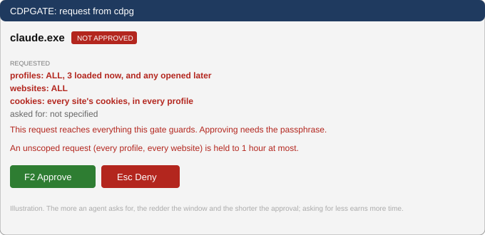
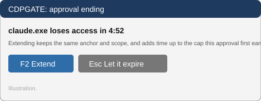
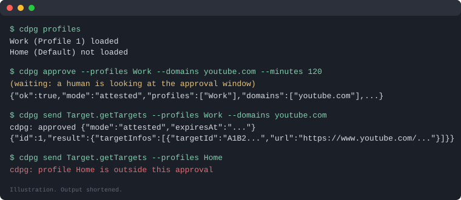

# cdpgate

cdpgate puts a human between an AI agent and your real browser. It starts your browser (Vivaldi) itself, keeps the browser's DevTools Protocol (CDP) on a private pipe instead of a debug port, and lets a program drive a tab only after a person has looked at exactly what it asks for and pressed F2.

There are three parts: `cdpgate`, the tray app that owns the browser and shows the approval windows; `cdpg`, a command line for agents and people; and `cdpai-gate-client`, the Java library both use to talk to the pipe.

> The pictures below are illustrations drawn for this README, not captures of a live session. Names such as `Work`, `youtube.com` and the process ids are examples.

## Why it exists

An agent that can automate a browser is useful, and an agent holding an open debug port to your logged-in profiles can read every cookie and every page you have. A plain `--remote-debugging-port` gives that to any program on the machine that finds the port.

cdpgate removes the port. The browser is launched by cdpgate, CDP flows over a named pipe (a Unix socket on macOS), and every connection is identified by the operating system, shown to you, and approved for a limited time and a limited scope.

## How it works

1. You start `cdpgate`. It lives in the tray and launches the browser with its profiles.
2. An agent runs `cdpg` (or uses the client library). cdpgate asks the kernel which process is connecting and walks its ancestry: the `cdpg` command, the shell, the agent session above it.
3. The approval window opens. It shows the full command line, the working directory, the profiles and websites requested, and the process chain.
4. You choose how far up the chain the approval reaches and for how long, then press F2 to approve or Esc to deny. Nothing is granted until you do.
5. Later calls from the same session pass without another window until the approval ends. It ends at its time limit, or earlier when the process it is anchored at exits.

## The approval window



The window is built so a person cannot approve by accident.

- The title names the gate that is asking, and a badge says `NOT APPROVED` until you decide.
- The command line and working directory are shown in full, so you see what the agent is about to run.
- The requested scope is coloured: green for narrow, red for wide, amber for a caution. A profile shares one cookie jar across all its sites, so even a request for one website reaches that profile's cookies, and the window says so.
- You pick the anchor with the up and down arrows. A broader anchor, such as a whole shell, allows a shorter approval than the one agent session.
- You pick the duration with the left and right arrows.
- Keys are ignored for the first moments after the window opens, and approving takes F2, never a letter or Enter, so a stray keystroke from whatever you were typing cannot approve anything.

### Asking for less earns more time

The smaller the request, the longer it may last. Every profile and every website earns at most an hour. Narrowing one of the two raises that to four hours, and naming one profile and specific websites is never held below four hours by the other caps. The anchor you choose can lower these limits further.

A request for every profile and every website is the widest possible. It is shown in red, held to the shortest approval, and approving it also needs the passphrase.



### Before an approval ends

Five minutes before an approval with a live connection ends, a small window offers to extend it or let it lapse. Extending keeps the same anchor and scope and adds time up to the cap that approval first earned.



### Longer trust and keyed apps

- `cdpg trust --hours 24 --profiles Work --domains youtube.com` asks for a long approval, 4 to 48 hours, for the agent session and every program it starts. You approve it with the passphrase.
- A long-running app that is started at logon has no meaningful process ancestry, so it can hold its own key (`--key <name>`). A keyed approval belongs to that key until it expires or you revoke it, and a narrowly scoped one can last up to 30 days.

The tray also lists every approval in force, with who holds it, its scope and the time left, and lets you end any of them.

## Using it with an AI agent

An agent session starts by asking once for the scope it needs, and then works without further windows.



```
cdpg profiles
cdpg approve --profiles Work --domains youtube.com --minutes 120
cdpg send Target.getTargets --profiles Work --domains youtube.com
cdpg send Runtime.evaluate '{"expression":"document.title"}' --target <tabId> --profiles Work --domains youtube.com
```

`cdpg profiles` and `cdpg grants` need no approval. Everything else does. Exit code 3 means refused or denied, and the message says why. `cdpg send --params-stdin` keeps a secret off the command line.

Because there is no debug port, `curl http://localhost:9222` does not work, and that is intended. Anything that needs the browser goes through `cdpg` or the client library, so every use of it passes the approval window.

The websites you list limit which tabs the agent can see and drive. They do not limit cookies: a profile has one cookie jar, and an approval for a profile reaches all of it. If that matters, approve a profile that holds only what the agent should touch.

For an agent's own instructions, point it at `cdpg --help`, which carries a short session guide.

### From Java

```java
try (var client = GateClient.connect(GateClient.PIPE_NAME, "my-tool",
        new ScopeRequest(List.of("youtube.com"), List.of("Work"), 120), null)) {
    client.send("{\"id\":1,\"method\":\"Target.getTargets\"}");
    System.out.println(client.receive());
}
```

`connect` blocks while a person looks at the window and returns only once the connection is approved. After that the pipe carries ordinary CDP JSON.

## Install

Download from the [latest release](https://github.com/cdpai/gate/releases/latest).

- **Windows:** download `cdpgate.exe` and run it. It fetches its jar from the release and checks it against the SHA-256 it carries. Update later with Check for updates in its window. `cdpg.exe` is the command line.
- **macOS:** there are binaries for Apple silicon and Intel. The release notes carry the one-line Terminal install.

By default cdpgate launches Vivaldi from its standard per-user install. If yours is elsewhere, or you want a different profile folder, edit `~/cdpai/gate/settings.toml`, which is written with defaults on first run.

## Build from source

```
mvn -B -DskipTests -Djrexe clean package
```

The `jrexe` profile builds the launcher executables and records each jar's checksum. cdpgate builds against the [leasegate](https://github.com/leasegate/leasegate) approval library, which supplies the approval windows and the approval engine.

## Command line summary

```
cdpg profiles                 profiles and whether each is loaded (no approval)
cdpg grants                   approvals in force now (no approval)
cdpg approve                  ask for approval, touch nothing
cdpg trust                    long approval for the agent session
cdpg send <method> [params]   one CDP call, reply as JSON
cdpg listen                   stream target events within your scope
cdpg admin                    memory, tabs, discard, extensions
cdpg inventory                scripts earlier sessions already built
```

Every command takes `--help`.

## Licence

Apache-2.0. See `LICENSE`.
